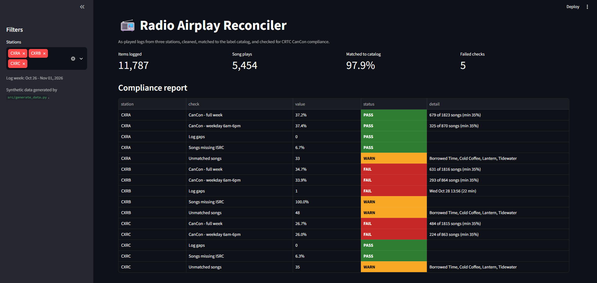

# 📻 Radio Airplay Reconciler

Radio stations log every song, ad and station ID they air, but each automation system exports that log in a different format. This project takes as-played logs from three stations, cleans them into one table, matches every song play to a record label's catalog, and checks each station against the CRTC's 35% Canadian content (CanCon) minimum.

**[Live dashboard →](#)** <!-- replace # with your Streamlit Cloud link -->



## What it found

One week of logs (Oct 26 – Nov 1, 2026), 11,787 items, 5,454 song plays:

| Station | CanCon (week) | CanCon (weekday 6am–6pm) | Issues |
|---|---|---|---|
| CXRA | ✅ 37.2% | ✅ 37.4% | — |
| CXRB | ❌ 34.7% | ❌ 33.9% | 22-minute logging gap Wed 13:56; no ISRCs logged |
| CXRC | ❌ 26.7% | ❌ 26.0% | — |

- **97.9% of song plays matched the catalog.** Without name cleaning, only 75% matched.
- **390 duplicate log entries** were removed.
- **4 songs aired that aren't in the catalog** (116 plays), flagged for review.

## How it works

1. **Load:** one loader per station handles its quirks:
   - CXRA: `M:SS` durations
   - CXRB: UTC timestamps, its own category names, no ISRC column
   - CXRC: 12-hour US-style dates, no song/ad column
   
   All three output the same 7-column schema.
2. **Combine and dedupe:** stack the stations and drop rows logged twice (same station, time and title).
3. **Clean:** normalize titles and artists: case, extra spaces, `(Radio Edit)` tags, `Feat`/`featuring`/`ft.` → `feat.`, and `Midnight Relay, The` → `the midnight relay`.
4. **Match:** ISRC first (an exact ID), then cleaned title + artist as a fallback.
5. **Check:**
   - CanCon share for the full week and for weekdays 6am–6pm (unmatched songs count as non-Canadian)
   - Logging gaps over 2 minutes
   - Unmatched songs
   - Missing ISRCs

## Run it locally

```bash
git clone https://github.com/williamwellington-Dev/radio-airplay-reconciler.git
cd radio-airplay-reconciler
python -m venv .venv
.venv\Scripts\activate        # Mac/Linux: source .venv/bin/activate
pip install -r requirements.txt
streamlit run app.py
```

You can also run the steps on their own: `python src/pipeline.py` prints the match summary, and `python src/checks.py` prints the compliance report.

## Project structure

```
app.py                  Streamlit dashboard
src/generate_data.py    Builds the synthetic catalog and station logs
src/pipeline.py         Load, combine, dedupe, clean, match
src/checks.py           CanCon and data-quality checks
data/raw/               Generated sample data
```

## About the data

All data is synthetic, made by `src/generate_data.py`. The station call signs, artists and tracks are fictional. The messiness is deliberate and modelled on real broadcast automation exports:
- inconsistent formats between systems
- duplicate entries
- missing ISRCs
- a logging gap
- a station that falls short on CanCon

## Built with

Python · pandas · NumPy · Streamlit · Altair

Built by [William Wellington](https://www.linkedin.com/in/william-wellington-819a1b317), a broadcast engineer working with radio automation and as-played logs day to day.
